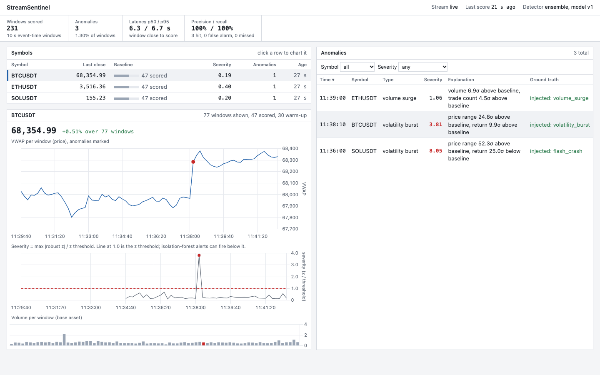
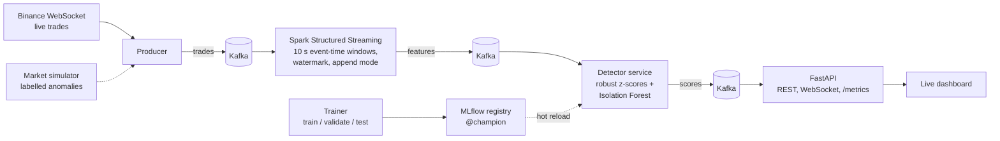

# StreamSentinel

Real-time anomaly detection on streaming market data. Live trades from Binance flow through
**Kafka** into a **Spark Structured Streaming** job that aggregates event-time windows; a
detector service scores every window with **robust per-symbol z-scores and an Isolation Forest**
served from the **MLflow** model registry; a **FastAPI** service streams the results to a live
dashboard and exposes Prometheus metrics. Everything runs with one `docker compose up`.


*Dashboard replaying the simulator stream through the trained ensemble detector. Injected anomalies are tagged so you can see hits, misses and false alarms.*



## Quickstart

Requires Docker (8 GB RAM recommended).

```bash
make up          # live Binance data
make up-sim      # or: simulated market with injected, labelled anomalies
```

| | |
|---|---|
| Dashboard | http://localhost:8000 |
| MLflow (experiments, registry) | http://localhost:5001 |
| API docs | http://localhost:8000/docs |
| Prometheus metrics | http://localhost:8000/metrics |

Host ports are configurable via `API_PORT` (default 8000) and `MLFLOW_PORT` (default 5001; macOS
uses 5000 for AirPlay) in `.env`.

The trainer runs once on startup and registers the first model. Until it finishes (about a
minute) the detector runs in z-score-only mode, then hot-swaps to the champion. Each symbol needs
30 windows (5 minutes) of history before it is scored.

## What happens to a trade

1. **Ingest.** The producer forwards every trade from Binance's public WebSocket (no API key) to
   the `trades` topic, keyed by symbol. It reconnects with exponential backoff.
2. **Aggregate.** Spark parses the JSON, assigns trades to 10-second tumbling windows **by event
   time** and emits each window once the watermark passes (late trades up to 3 s still count).
   Per window and symbol: trade count, volume, VWAP, OHLC, price range and taker-buy share.
3. **Score.** The detector turns five scale-free features (log return, range, log volume,
   log trade count, taker-buy share) into robust z-scores against that symbol's rolling baseline
   (median/MAD over the last 30 minutes). The Isolation Forest scores the z-vector. The mode
   and thresholds come from the registry.
4. **Explain.** Anomalies are typed after the most deviant feature (`price_crash`,
   `volume_surge`, `buy_pressure`, ...) and explained in plain words, e.g.
   *"volume 9.1σ above baseline, taker-buy share 4.3σ above baseline"*.
5. **Serve.** The API keeps a live view, persists anomalies in SQLite and pushes every score to
   the dashboard over a WebSocket.

## Results

Live market data has no ground truth, so the model is evaluated on the simulator: Poisson trade
arrivals, heavy-tailed trade sizes, drifting activity and volatility regimes, plus five injected
anomaly types with randomised intensity (some deliberately close to noise). Thresholds are
chosen on a validation stream; the numbers below are on a separate, unseen test stream
(4 hours, 3 symbols, about 4,200 windows).

| Detector | Precision | Recall | F1 | False alarms / hour |
|---|---:|---:|---:|---:|
| Robust z-score | 0.82 | 0.83 | 0.82 | 3.75 |
| Isolation Forest | 0.83 | 0.77 | 0.80 | 3.25 |
| **Ensemble (selected on validation)** | **0.95** | 0.70 | 0.81 | **0.75** |

Recall by anomaly type for the selected detector: flash crash 1.00, pump 1.00, volatility burst
0.90, volume surge 0.56, whale trade 0.41. Single block trades are the hardest case: one large
trade barely moves 10-second volume when trade sizes are already heavy-tailed.

Reproduce with `python -m streamsentinel.training.train --no-mlflow`.

The simulator labels travel with the trades through Kafka and Spark, so in `make up-sim` mode
the dashboard shows **live** precision and recall next to the detections.

## Design decisions

- **Event time, not processing time.** Windows are built from the exchange timestamp with a
  watermark, so network jitter does not move trades into the wrong window, and every window is
  emitted exactly once.
- **Robust statistics.** Median/MAD baselines are not pulled around by the outliers they are
  meant to catch, and per-symbol baselines make BTC and SOL comparable even though their
  volumes differ by orders of magnitude.
- **Isolation Forest on z-scores, not raw features.** The model sees symbol-agnostic inputs, so
  one model covers all symbols and catches combinations of moderately unusual features.
- **One feature definition, tested twice.** Spark computes features in production, pandas
  offline. `tests/test_spark_parity.py` asserts both produce identical output, so offline
  evaluation reflects what runs live.
- **Registry as the source of truth.** Mode and thresholds are stored with the model. A new run
  is only promoted to `@champion` if it beats the current champion on the test set, and the
  detector picks it up without a restart and without losing its baselines.
- **Observable pipeline.** Detection latency (window close to alert), scored windows and
  anomalies per type are exported as Prometheus metrics.

## Project layout

```
src/streamsentinel/
  producers/       binance.py (live), simulator.py (labelled replay)
  streaming/       spark_job.py — Spark Structured Streaming feature job
  services/        detector_service.py — scoring, model hot reload
  api/             FastAPI app, live state, dashboard
  training/        dataset building, threshold selection, MLflow logging
  features.py      feature definitions (pandas reference)
  detector.py      robust baseline, Isolation Forest scoring, explanations
  simulator.py     synthetic market with injected anomalies
tests/             unit, Spark parity, end-to-end pipeline, API, training/registry
```

## Development

```bash
python -m venv .venv && source .venv/bin/activate
make install     # needs Java 17+ for the Spark tests
make test
make lint
```

## Limitations and next steps

- Thresholds are tuned on synthetic data. Real crypto markets are heavier-tailed, so live data
  produces more alerts; `Z_THRESHOLD=8` in `.env` is a reasonable starting point. Next step:
  record live feature windows and recalibrate the false-alarm rate on them.
- Cross-symbol anomalies (e.g. a market-wide sell-off) are scored per symbol only.
- Single-node Kafka and Spark `local[2]`; the job itself scales by adding partitions and executors.

## License

MIT
